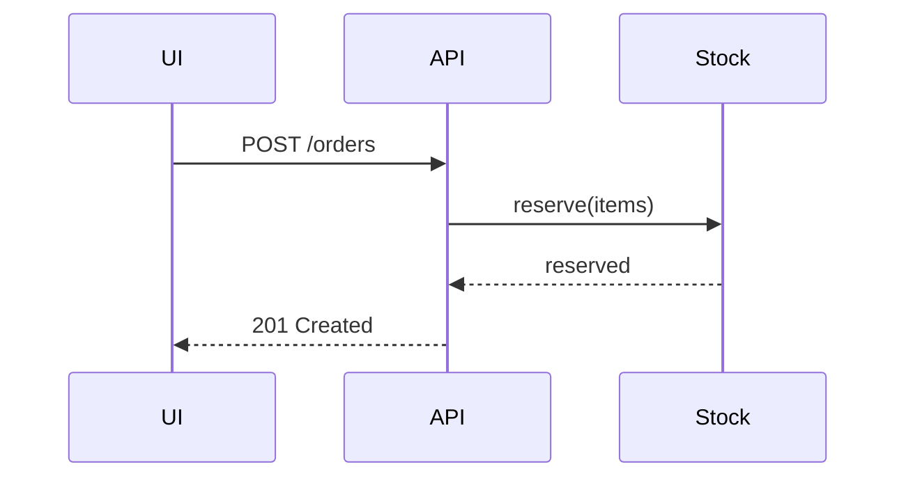

# PR body examples

Pick one Summary view per PR, two at most. Each example below shows one view and
the kind of change it suits. The fictional project is a small shop with an
order service.

## Summary views

**Pseudocode** for a rule or an algorithm:

```text
applyDiscount(order)
  if order.coupon is expired -> reject with "coupon expired"
  if order.total < coupon.minimum -> keep full price
  else subtract coupon.amount, never below zero
```

**Call tree** for a changed runtime path:

```text
POST /orders
  validateCart
  reserveStock        # new: runs before payment
  chargePayment
  sendConfirmation
```

**Component tree** for UI structure, with the state that matters:

```text
<CheckoutPage>              routes/checkout.tsx
  useCart()                 cart state
  <AddressForm>
  <OrderSummary>            new, reads useCart()
  <PayButton disabled={!cart.valid}>
```

**File tree** for a refactor that moves responsibilities:

```text
src/orders/
  validate.ts   # cart rules, was in checkout.ts
  stock.ts      # reservation, new
  checkout.ts   # orchestration only
```

**Mermaid** for an interaction between parts (renders on GitHub and GitLab, not
in a terminal):



**Shaped diff** when the surrounding structure already exists and only a part
changes:

```diff
 POST /orders
   validateCart
+  reserveStock
   chargePayment
-  sendConfirmation
+  enqueueConfirmation
```

## Evidence examples

Visual change:

```markdown
- **Before:** `checkout-desktop-before.png`: the summary column is missing.
- **After:** `checkout-desktop-after.png`, `checkout-mobile-after.png`: summary
  shows items and total; checked 4 of 4 captures.
- **Reproduce:** `npm run dev`, then `node scripts/capture.mjs flow.json /tmp/ev`
- **Gaps:** the error state was not captured (no fixture for a failed payment).
```

Logic change, as a red/green test:

```text
test "expired coupon is rejected"
  base  (a1b2c3d): FAIL  expected error "coupon expired", got total 80.00
  head  (e4f5a6b): PASS
```

Server or data change, as changed output:

```text
$ npm run orders:report -- --day 2026-01-01
before: 12 orders, 3 without stock reservation
after:  12 orders, 0 without stock reservation
```

## Merge Danger examples

```markdown
**Door:** two-way (agent's claim: no schema or data change; reverting the
commit restores the old checkout path completely)

**Blast radius:** checkout page layout on narrow screens
```

```markdown
**Door:** one-way (agent's claim: the migration drops `orders.legacy_status`;
a revert cannot restore the dropped values. Listed as always one-way in
AGENTS.md: "schema migrations that drop data")

**Blast radius:** every report that reads `legacy_status`; nightly export job
```
